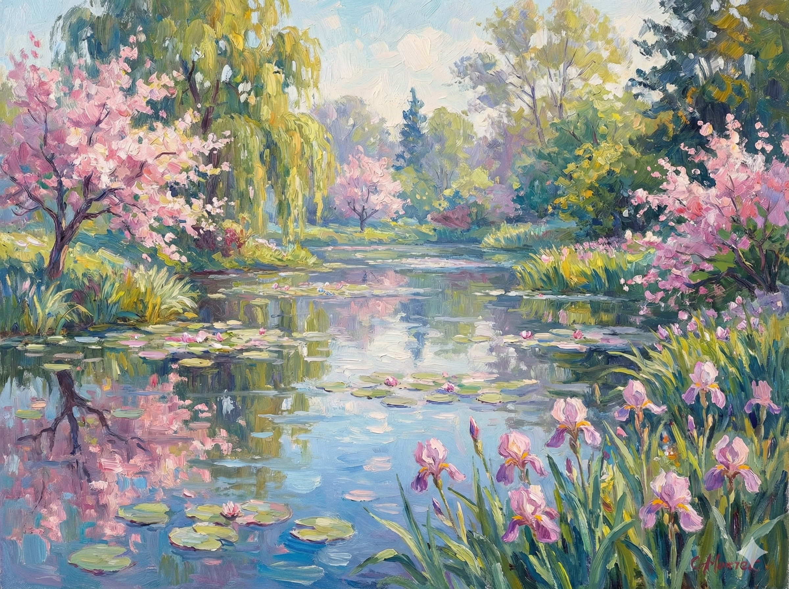

# 🎨 AI Wallpaper Skill

[中文介绍](#-中文介绍) | [English](#-english)

---

## 🇨🇳 中文介绍

**把你随手拍下来的那一瞬间，变成一张真正适合当壁纸的作品。**

`wallpaper_skill` 是一个面向 OpenClaw / AI Agent 的壁纸生成 Skill。  
它不只是“把图片交给模型重新生成一下”，而更像一个会看图、会推荐风格、会帮你把普通照片变得更适合做壁纸的创作助手。

你拿着手机，随手拍下一张风景、一张宠物照、一张花艺图、一张生活场景图，或者任何你觉得“这张图挺美”的瞬间——然后把它交给你的龙虾助手，它会尽量沿着更自然的创作流程工作：

1. 先看图
2. 判断氛围与主体
3. 推荐更适合的壁纸风格
4. 生成静态壁纸
5. 如有需要，再继续生成动态壁纸

---

## 项目介绍

很多图像工具会直接问你：

- prompt 是什么？
- 想要什么风格？
- 要不要改背景？
- 要不要加光影？

而 `wallpaper_skill` 更偏向一种更符合直觉的体验：

**先理解这张图，再判断它适合什么样的壁纸。**

它想做的不是一个生硬的命令执行器，而是一个更像“壁纸创作助手”的东西。

也就是说，它关心的不只是“把图生成出来”，而是：

> 这张照片，如果真的要做成壁纸，应该往什么方向走，会更好看？

---

## 使用场景

这个 Skill 最适合下面这种非常自然的日常场景：

- 你在路上随手拍下一张很有氛围的天空
- 你旅行时拍到一张漂亮的风景
- 你拍到一束花、一只猫、一张很干净的生活照
- 你看到一张图，觉得“它很好看，但如果做成壁纸可能还能更好”

这时候，你不需要自己研究复杂参数。  
你只需要把图交给你的龙虾助手，然后说一句类似：

- “帮我把这张图做成壁纸”
- “先看看适合什么风格，再帮我生成”
- “做成新海诚风格”
- “做成动态壁纸”

---

## 核心能力

`wallpaper_skill` 当前支持：

- 基于输入图片生成静态壁纸
- 根据图片内容自动推荐更适合的风格
- 支持用户指定风格生成
- 支持在未知风格下自动构造 fallback prompt
- 支持基于静态壁纸继续生成动态壁纸脚本
- 支持在需要时进一步生成动态视频
- 支持中文语境下更自然的交互体验

---

## 内置风格库

这个 Skill 当前内置了 **30+ 专业风格**，覆盖：

- 艺术风格
- 动漫与电影感风格
- 治愈系 / 清新系 / 梦幻系风格
- 当下流行的视觉风格
- 更适合壁纸呈现的构图与审美方向

这些风格不是静态不变的。  
风格库会持续更新，我们也希望它慢慢成长为一个更专业、更开放的“壁纸风格专家库”。

---

## 动态壁纸能力

除了静态壁纸之外，`wallpaper_skill` 还支持继续生成动态壁纸流程。

也就是说，你可以先得到一张更适合做壁纸的静态图，  
再基于这张静态壁纸生成对应的动态效果方向，例如：

- 微风吹动
- 光影波动
- 轻微镜头感运动
- 花朵、树叶、水面、天空等元素的柔和变化

这样它就不只是帮你“做一张图”，而是可以进一步把它变成一个更完整的壁纸作品。

---

## 示例展示

这个 Skill 最直观的价值，不在于“它能执行命令”，而在于它能把一张普通照片，转化成更适合做壁纸的视觉结果。

下面预留了一些示例展示位，后续可以逐步补充不同类型图片的生成效果。

### 输入图 → 静态壁纸 → 动态壁纸

#### 风景示例
**Monet 花园**  

  

---

## 如何安装

如果你想把这个 Skill 接到你自己的 OpenClaw / AI Agent 里，  
不需要自己手动一步一步研究怎么部署。

你只需要在你的 Agent 里输入一句类似的话：

> 请帮我添加一个生成壁纸的 Skill，请访问：  
> `https://github.com/mayuhao-213/wallpaper_skill/AI.md`  
> 然后按照里面的内容一步一步执行。  
> 如果过程中需要 Google API Key，请向我询问，并根据我的输入创建 `.env` 文件。

## 🌍 English

Turn a quick photo into a wallpaper that actually feels like one.

`wallpaper_skill` is a wallpaper generation skill for OpenClaw / AI Agents.  
It is not just a simple “send image to a model and regenerate” tool. Instead, it behaves more like a creative assistant that can look at an image, understand its mood, recommend suitable styles, and transform an ordinary photo into something that works better as a wallpaper.

You take a casual photo on your phone — a landscape, a pet, a flower arrangement, a daily-life scene, or any moment that simply feels beautiful — and hand it over to your lobster assistant. It will try to follow a more natural creative process:

1. Look at the image  
2. Understand the mood and subject  
3. Recommend a more suitable wallpaper style  
4. Generate a static wallpaper  
5. If needed, continue into a live wallpaper workflow  

---

## Project Overview

Many image generation tools start by asking:

- What is your prompt?
- What style do you want?
- Do you want to change the background?
- Do you want more lighting or atmosphere?

`wallpaper_skill` is built around a more intuitive experience:

**Understand the image first, then decide what kind of wallpaper it should become.**

Its goal is not to act like a rigid command runner, but more like a “wallpaper creation assistant.”

In other words, it cares not only about generating an image, but about answering this question:

> If this photo is truly going to become a wallpaper, what direction would make it look better?

---

## Use Cases

This skill is designed for very natural, everyday scenarios such as:

- You quickly take a photo of a beautiful sky on your way home
- You capture a nice travel landscape
- You photograph a flower arrangement, a cat, or a clean everyday scene
- You see a photo and feel: “This already looks nice, but it could become an even better wallpaper”

In that case, you do not need to study complicated parameters.  
You can simply hand the image to your lobster assistant and say things like:

- “Turn this image into a wallpaper”
- “First tell me what style fits this image, then generate one”
- “Make it Makoto Shinkai style”
- “Turn it into a live wallpaper”

---

## Core Features

`wallpaper_skill` currently supports:

- generating static wallpapers from an input image
- recommending more suitable styles based on image content
- supporting user-specified styles
- automatically building fallback prompts for unknown styles
- continuing from static wallpaper into live wallpaper script generation
- optionally continuing into live video generation
- supporting more natural interaction in Chinese-language scenarios

---

## Built-in Style Library

This skill currently includes **30+ curated styles**, covering:

- artistic styles
- anime and cinematic-inspired looks
- healing / clean / dreamy visual directions
- currently popular aesthetics
- compositions and visual treatments that work especially well for wallpapers

These styles are not fixed forever.  
The style library will keep evolving, and we hope it gradually grows into a richer and more open “wallpaper style expert library.”

---

## Live Wallpaper Capability

Beyond static wallpapers, `wallpaper_skill` can continue into a live wallpaper workflow.

That means you can first get a polished static wallpaper, and then continue from it into motion-based directions such as:

- gentle wind movement
- subtle lighting changes
- soft camera-like motion
- flowers, leaves, water, or sky elements moving in a calm and natural way

So the skill is not only about “making a new image” — it can also help turn it into a more complete wallpaper experience.

---

## Showcase

The most intuitive value of this skill is not that it can execute commands, but that it can turn an ordinary photo into something that feels more suitable as a wallpaper.

Below are placeholder showcase sections that can be expanded over time with different categories of examples.

### Input Image → Static Wallpaper → Live Wallpaper

#### Landscape Example
**Monet Garden**  

  

---

## How to Install

If you want to add this skill to your own OpenClaw / AI Agent,  
you do not need to manually go through every deployment step yourself.

You can simply ask your agent with something like:

> Please help me install a wallpaper generation skill.  
> Visit:  
> `https://github.com/mayuhao-213/wallpaper_skill/AI.md`  
> and follow the instructions step by step.

In other words:

- `README.md` is for humans
- `AI.md` is for OpenClaw / AI Agents to execute deployment automatically